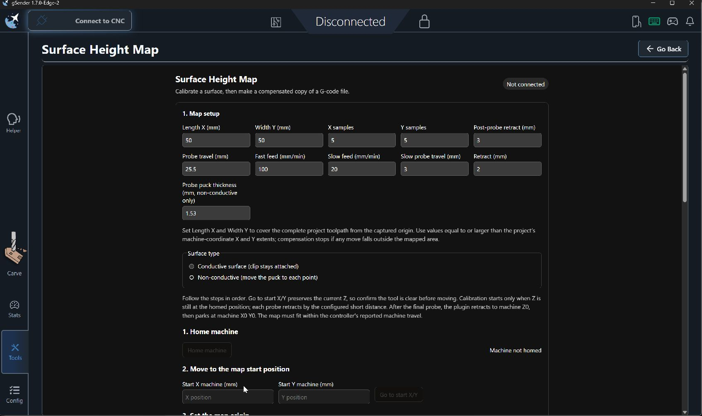
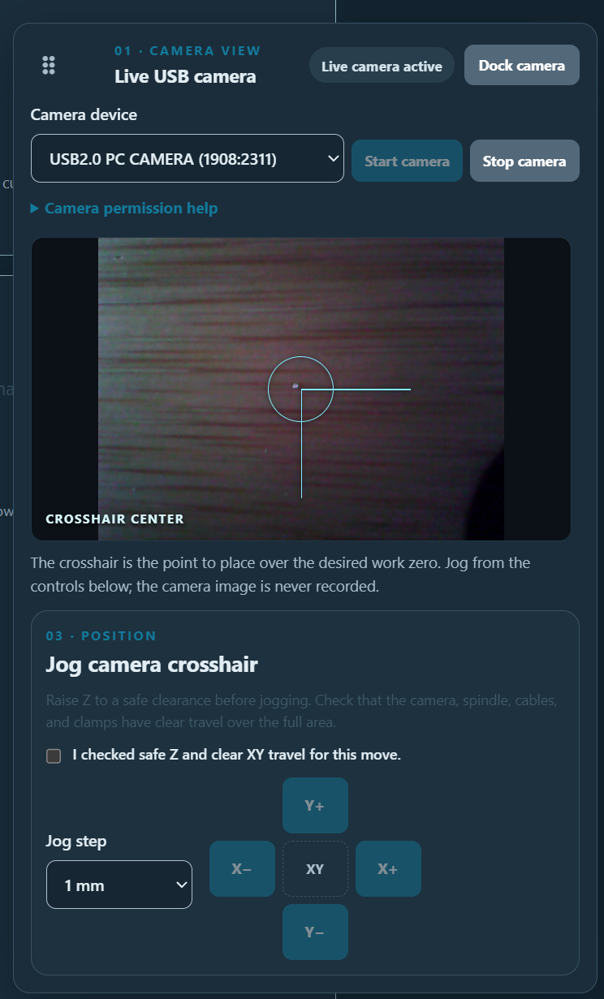
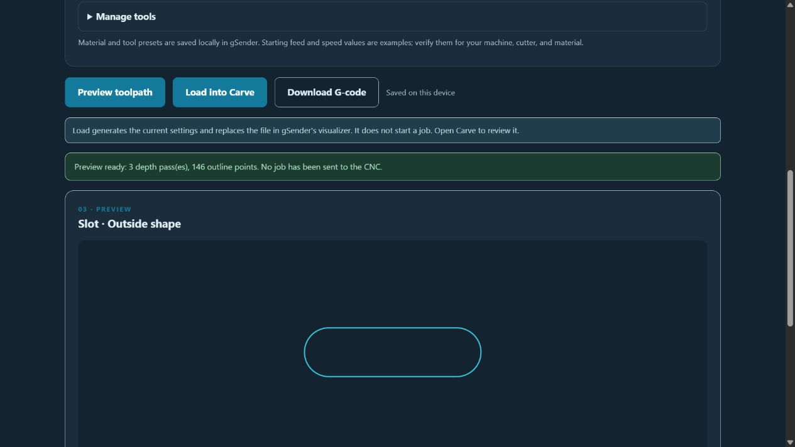

# gSender Plugins

Source repository for gSender plugins maintained by Bakstaaj. The two height map plugins use version subfolders that hold the current source snapshot and matching install ZIP. Spindle Tramming 0.4.2 remains at its original plugin folder root; its next source snapshot will use the same versioned layout.

## Plugins

- [Spindle Tramming](spindle-tramming/README.md) — version 0.4.2; interactive spindle tramming for gSender 1.7.0-Edge-2.
- [Surface Height Map](surface-height-map/v0.1.22/README.md) — version 0.1.22; probe-based surface calibration and G-code compensation.
- [Surface Height Map (File First)](surface-height-map-file-first/v0.1.6/README.md) — version 0.1.6; contour-aware probing, rectangular fallback, and selectable work-zero compensation.
- [Camera Align & Print Registration](camera-align-print-registration/v0.2.0/README.md) — version 0.2.0; live camera, selectable G54–G59 work zero, and two-point printed-artwork registration.
- [CNC Camera Monitor](camera-monitor/v0.1.8/README.md) — prototype 0.1.8; optional second camera, feed health, picture controls, and full-height Fill view.
- [G-code Job Cost Estimator](job-cost-estimator/v0.1.0/README.md) — prototype 0.1.0; local runtime and job-cost estimates, safe-height review, and read-only XY path analysis.
- [Basic Shape CAM](basic-shape-cam/v0.1.3/README.md) — prototype 0.1.5; generate-and-load-to-visualizer for Carve review, plus downloadable profiles for rectangles, squares, circles, ovals, slots, triangles, and regular polygons.

## Plugin screenshots

| Plugin | Preview |
| --- | --- |
| [Spindle Tramming](spindle-tramming/README.md) |  |
| [Surface Height Map](surface-height-map/v0.1.22/README.md) |  |
| [Surface Height Map (File First)](surface-height-map-file-first/v0.1.6/README.md) |  |
| [Camera Align & Print Registration](camera-align-print-registration/v0.2.0/README.md) |  |
| [CNC Camera Monitor](camera-monitor/v0.1.8/README.md) |  |
| [G-code Job Cost Estimator](job-cost-estimator/v0.1.0/README.md) |  |
| [Basic Shape CAM](basic-shape-cam/v0.1.3/README.md) |  |

## Version folder layout

```text
<plugin-name>/
  v<version>/
    src/                 plugin source
    test files/          automated tests and fixtures
    ui/                  built interface for gSender
    <plugin>-v<version>.zip  install package for this version
```

Keep the matching source, built UI, manifest, README, and install ZIP together in each version folder. For every new release, add a new version folder and preserve previous snapshots. Never combine multiple plugins into one install package.

## Development

Run npm commands from the version folder you are working on. Example:

```powershell
cd surface-height-map\v0.1.22
npm ci
npm test
npm run build
.\package-plugin.ps1
```

The same workflow applies to the other plugins that provide an npm project and packaging script. Do not commit `node_modules/` or generated `dist/` contents.

## GitHub Releases

Use a separate tag and GitHub Release for each plugin version, such as `surface-height-map-v0.1.22` or `surface-height-map-file-first-v0.1.4`. Attach the matching install ZIP from that version folder to its GitHub Release. The ZIP can also be downloaded directly from the repository's version folder.


