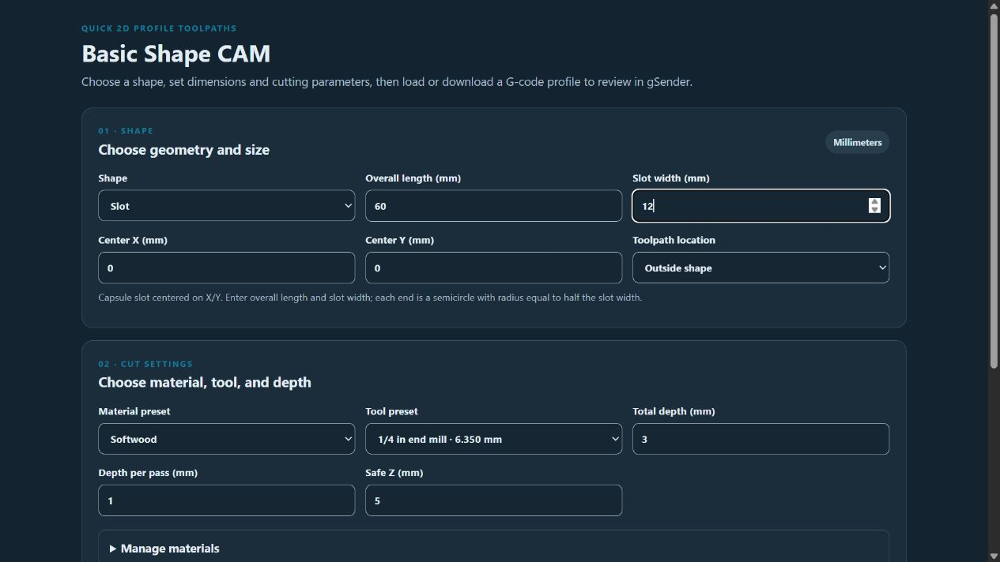

# Basic Shape CAM

**Prototype version 0.1.3 · gSender 1.7.0-Edge-2 · Plugin SDK 0.2.2**

Generate simple, closed 2D profile toolpaths and load them into gSender Carve for review or download them as G-code.

## Screenshots

The slot form sets the overall length and fixed width, with full-radius semicircular ends. The preview shows the generated outside profile before it is loaded into Carve or downloaded.

## Shapes

- Rectangle and square
- Circle and oval/ellipse
- Slot with straight sides and semicircular ends
- Isosceles triangle
- Regular polygon with 3–32 sides

Every shape is centered on the entered X/Y position. A profile can run inside, on, or outside the nominal boundary using tool-radius compensation. Oval and circle profiles are approximated with short linear segments.

For a slot, enter the overall end-to-end length and the slot width. The ends use a full semicircle with radius equal to half the slot width, so the overall length must be at least the slot width. Slots are oriented along X.

## Cutting setup

Set total depth, step-down per pass, and safe Z. Select a material preset for spindle speed, feed rate, and plunge rate, and select a tool preset for tool number and diameter. Material and tool presets can be added or deleted and are saved locally in gSender.

Starter material settings are examples only. Verify speeds and feeds for your machine, spindle, cutter, and stock. The generated file uses millimeters, absolute coordinates, XY plane, feed-per-minute mode, and G54.

## Safety and limitations

This prototype generates **profile cuts only**. It does not generate pockets or add tabs, ramps, lead-ins, or automatic collision checks. Z plunges are vertical at the configured plunge rate. Plan workholding and entry points accordingly.

Use **Load into Carve** to generate the current settings and send the G-code to gSender's main visualizer job, then open Carve in gSender to review it. Loading replaces the currently loaded visualizer job. It does not send G-code to the controller or start a CNC job. No machine limits, stock dimensions, fixture locations, or clamp clearances are known to this generator.

## Install

Run `npm ci`, `npm run build`, then `package-plugin.ps1` from this version folder. Import `basic-shape-cam-v0.1.3.zip` with gSender's plugin manager. Approve the plugin's Visualizer Load permission. If the plugin remains open on the Tools page, open Carve in gSender to see the loaded file. The generated file is only loaded for review; no job starts.
