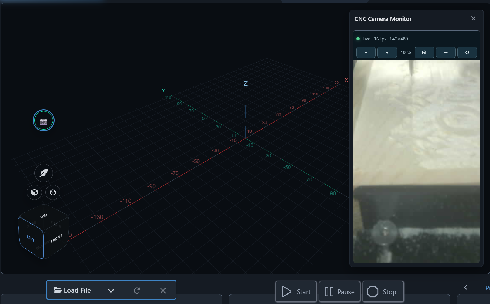

# CNC Camera Monitor

The latest source snapshot and install package are in [version 0.1.9](v0.1.9/README.md). The plugin shows USB and supported network camera feeds in gSender, including an optional second camera and a view-only overlay over the Carve workspace.

For ONVIF or RTSP cameras, install the separate [CNC Camera Monitor Local Bridge](../camera-monitor-local-bridge/v0.1.0/README.md). The bridge runs outside gSender and restreams named feeds through go2rtc for browser playback.

See the [plugin guide](v0.1.9/README.md) for setup, supported camera sources, two-camera configuration, and screenshots.
