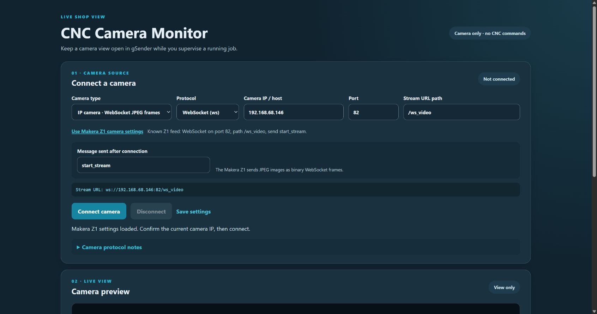
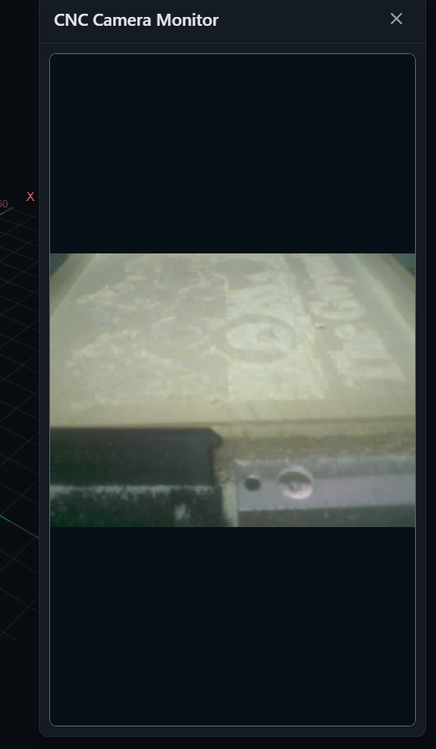
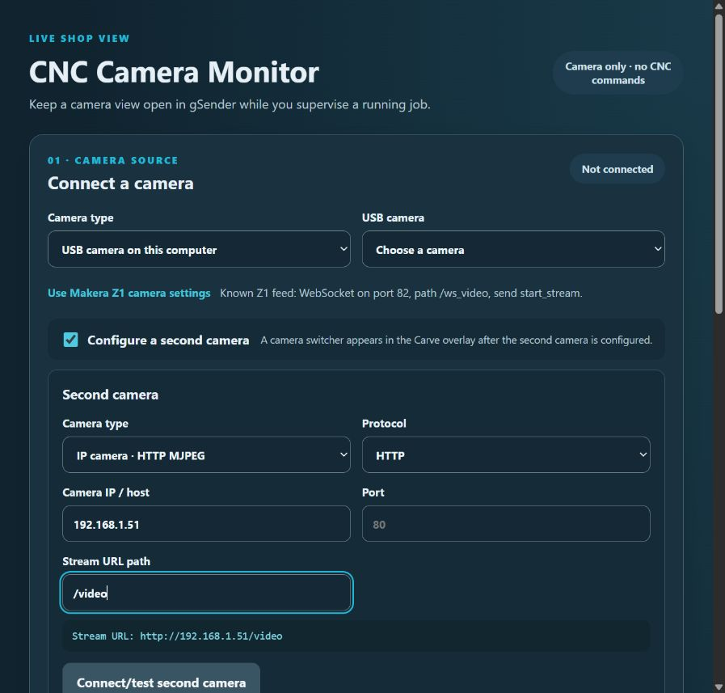

# CNC Camera Monitor

**Prototype 0.1.8 · gSender 1.7.0-Edge-2 · Plugin SDK 0.2.2**

A view-only camera plugin for monitoring USB and compatible network camera feeds while gSender runs a CNC job. It does not access machine controls, send G-code, or change job state.

## Screenshot

The Makera Z1 preset fills the editable IP camera settings and shows the connection URL before the user connects.

## Camera sources

- **USB camera:** uses the computer’s browser camera permission and media capture.
- **HTTP MJPEG:** displays a multipart JPEG stream from an IP camera.
- **JPEG snapshots:** refreshes one JPEG URL at a chosen interval.
- **WebSocket JPEG:** receives binary JPEG frames and can send a text start command.
- **Browser video URL:** uses codecs supported by the Chromium build embedded in gSender. HLS support varies by build.

## View the camera over Carve

Connect the camera from the Tools page. A successful connection saves the selected camera settings automatically. In Carve, select the **📷 camera icon** in the visualizer controls to open CNC Camera Monitor as a gSender visualizer overlay. The plugin reconnects using the saved camera settings when that overlay opens. The viewer stays over the Carve workspace while it remains open, so you can keep the camera feed in view while returning to the toolpath and normal Carve controls. Closing the overlay stops the camera feed.

The screenshot shows the overlay open on top of the Carve visualizer. The camera icon opens this view; the exact position of gSender’s visualizer controls can vary with its layout and version. The feed is view-only and does not start, pause, stop, or change the CNC job.

This uses gSender's supported visualizer overlay. The plugin iframe does not have permission to open separate windows.

The Carve visualizer overlay keeps camera monitoring separate from CNC controls. Its small feed-health indicator reports when frames stop arriving; MJPEG sources are marked connected because Chromium does not expose reliable per-frame timing for those streams. The view defaults to Fill so the image uses the full preview height; Fit, zoom, flip, and rotate controls remain available. The outer overlay size is set by gSender.

### Makera Z1

Choose **Use Makera Z1 camera settings**, confirm the current camera IP, then connect. The preset reflects the known feed:

- WebSocket URL: ws://192.168.68.146:82/ws_video
- Start text: start_stream
- Incoming data: binary JPEG frames

The address is editable because the machine’s IP can change. A successful connection in another client does not guarantee the gSender plugin frame or camera firmware will accept its WebSocket origin; confirm this on the target setup.

## Optional second camera

On the Tools page, select **Configure a second camera**, choose its source type, and enter the USB device or network stream details. Connect/test the second camera to confirm its feed. Once enabled and configured, **Camera 1** and **Camera 2** buttons appear in the Carve overlay; if the second camera is disabled or incomplete, the switcher stays hidden. Both camera profiles are saved in gSender plugin storage.

The screenshot uses an example MJPEG address (`192.168.1.51/video`) to show the fields; it is not a connected camera. Use your camera’s actual stream address. The switcher appears after the second profile is enabled and has a valid source.

## Network camera setup

Set the protocol, camera IP or host, port, and stream path. The displayed URL is assembled from these values. For example, an HTTP MJPEG camera might use http://192.168.1.50:8080/video.

Camera brands vary in URL paths, authentication, codecs, and firmware. Use the stream endpoint documented by your camera. This plugin does not discover IP cameras or bypass camera credentials.

**RTSP does not play directly in a browser.** Restream RTSP from a local service as MJPEG, a browser-compatible HTTP video stream, or WebRTC, then configure the resulting browser endpoint here. Browser HLS playback depends on the installed Chromium build and is not guaranteed.

Direct network feeds may also be affected by gSender’s plugin-frame network policy, the computer firewall, HTTPS/mixed-content rules, or a camera that rejects browser-originated connections. USB uses Camera/media permission; network access relies on the app and camera allowing the connection.

## Safety and privacy

- The camera panel is view-only and independent of CNC job controls.
- The plugin does not start, pause, stop, or alter a CNC job.
- Video frames are held in the current gSender view and are not recorded or uploaded by this plugin.
- Camera settings are stored with gSender plugin storage.
- Use the normal machine controls and direct observation to supervise a running CNC.

## Development

From this version folder, run npm ci and npm run build. Import the built ui/ folder with gsender-plugin.json through the gSender plugin manager. This version targets gSender 1.7.0-Edge-2.

This is an initial implementation. USB behavior, camera permissions, MJPEG endpoints, network policy, and the Makera Z1 WebSocket must be verified in the target gSender installation and on the camera’s network.

