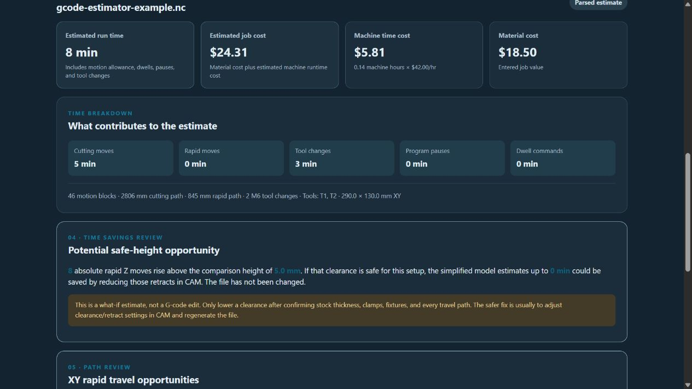
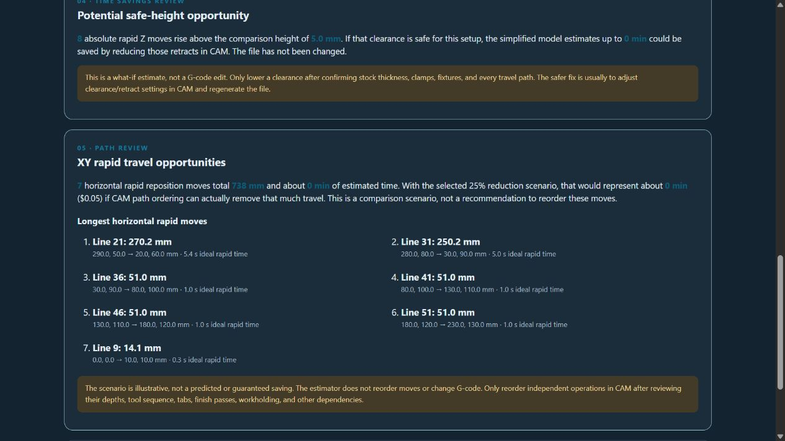

# G-code Job Cost Estimator

**Version 0.1.0 · Prototype · gSender 1.7.0-Edge-2 · Plugin SDK 0.2.2**

Estimate CNC job runtime and cost from a G-code file before sending it to the machine. The plugin reads the selected file locally in gSender; it does not upload, modify, or send the file to the CNC.

## Screenshots

The example below shows a sample G-code estimate with material and machine costs, motion breakdown, and a safe-height review. The separate path review lists long XY rapid moves and labels possible savings as a what-if scenario.





## Features

- Estimate G0 rapid time and G1/G2/G3 cutting time from programmed feed rates.
- Estimate G17 arc length from I/J or R arc definitions where possible.
- Include a configurable motion allowance for acceleration, look-ahead, and machine behavior.
- Account for G4 dwells, M0/M1 pauses, and manual or automatic M6 tool changes.
- Calculate machine cost from a saved hourly rate and add the entered material cost.
- Review high rapid Z-only moves against a user-entered clearance height.
- Review horizontal XY rapid travel, including the longest moves and their source line numbers.
- Compare illustrative XY travel-reduction scenarios. The plugin does not reorder paths or edit G-code.
- Save shop settings on the local device.

## Install

1. Download `gcode-job-cost-estimator-v0.1.0.zip` from this folder or the matching GitHub Release.
2. In gSender, open the plugin manager and import the ZIP.
3. Open **G-code Job Cost Estimator** from the Tools page.

## Use

1. Select a `.nc`, `.gcode`, `.ngc`, `.tap`, or text G-code file.
2. Set the rapid rate, machine hourly cost, material cost, tool-change mode and time, pause time, and motion allowance to match your setup.
3. Set the safe-Z comparison height relative to the job's work zero.
4. Choose an XY rapid reduction scenario to compare against the parsed horizontal rapid travel.
5. Select **Analyze G-code** and review the estimate and parser notes.

The XY report lists the longest horizontal rapid moves with line numbers and endpoints to help locate expensive transitions in the CAM project. The reduction percentage is only a what-if calculation against estimated horizontal rapid time. It does not mean those moves can safely or practically be removed.

## Estimate assumptions and limits

The estimator models standard modal G-code with X/Y/Z axes and normalizes distances to millimeters. It treats GRBL-style `G4 P` dwell values as seconds. Rapid moves use the configured rapid rate. Cutting moves use programmed feed, and all estimated motion time is multiplied by the selected motion allowance.

Rotary axes are reported but excluded from distance calculations. Macros and expressions, canned cycles, G28/G30, G53, G92, inverse-time feed, non-XY arcs, missing feed rates, and other unusual commands can produce warnings or incomplete estimates. Read all parser notes and compare estimates with actual machine cycle times before relying on the result.

Safe-height and XY path sections are analysis only. They do not generate an adjusted file. Change retract heights in CAM only after checking stock, clamps, fixtures, and the full travel path. Path reordering should be done in CAM and only for independent operations; arbitrary G-code line reordering can break operation dependencies, tabs, finish passes, depth order, and tool sequence.

Estimates exclude setup, operator labor, workholding time, spindle warm-up, tool wear, and unmodeled controller or machine delays. This is a planning estimate, not a machine-time guarantee.

## Build and package

From this version folder, run:

```powershell
npm ci
npm run build
.\package-plugin.ps1
```

The packaging script creates `gcode-job-cost-estimator-v0.1.0.zip`, containing the manifest, this README, and the built `ui/` files. Source code remains available in `src/` in this repository.
