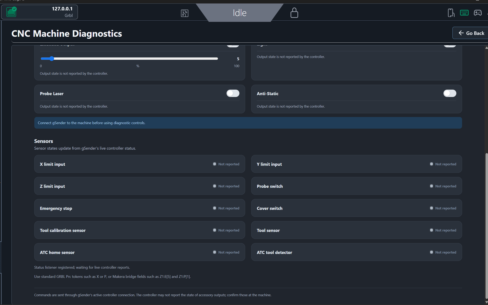

# CNC Machine Diagnostics for gSender

A configurable diagnostics page for CNC machines connected to gSender. Build a machine profile that shows the controls and sensor indicators your controller supports, and set the G-code used by each control.



## What it does

- Create, copy, rename, select, and delete machine profiles.
- Enable only the controls and sensors supported by a machine.
- Configure each control as a toggle, a value slider with a toggle, or a one-shot command.
- Map sensor indicators to GRBL `Pn:` status tokens or controller-specific fields parsed by gSender.
- Poll controller status every 700 ms and update sensor indicators from the latest report.
- Save profiles in gSender so they persist between sessions.

The plugin sends commands through gSender’s active controller connection. A successful send means gSender accepted the command; it does not by itself confirm an accessory physically changed state.

## Makera Z1 profile

The included profile is configured for the Makera Z1 and works with the independent Makera Z1 TCP Bridge. The bridge converts the Z1’s TCP protocol and extended sensor information into GRBL-compatible communication. The plugin itself is separate from the bridge and can be configured for other controllers.

The Z1 profile includes spindle and fan controls, extended output, light, anti-static, beeper, probe laser, laser mode, and a separate laser beam test. It maps standard X/Y/Z/probe inputs and Makera status fields for the cover, E-stop, calibration sensor, tool sensors, ATC sensors, rotary limit, and motor alarm.

### Laser controls

- **Laser mode** switches the controller mode using `M321.2` and `M322.2`. The Z1 changes fan outputs during this mode change. This control does not itself emit the laser beam.
- **Laser beam test** uses the firmware test path: enter laser mode, set the test power scale with `M325 S…`, and enable the test output with `M323`. `M324` turns the test output off. The slider sets 0–100% of the firmware-configured test power; the firmware default is 10%, but the Z1 configuration may differ.
- The beam test control is enabled only when gSender reports **Idle**. It emits the actual laser beam. Use an appropriate enclosure and a safe beam path.

Other included Z1 controls use the firmware commands captured or confirmed for this machine, including `M3S{value}` / `M5` for spindle, `M811S{value}` / `M812` and `M801S{value}` / `M802` for fans, `M822` for light, and `M331.4` / `M332.4` for anti-static.

## Install

1. Install and configure the Makera Z1 TCP Bridge separately if using a Z1.
2. In gSender, open the Plugin Manager and install `cnc-machine-diagnostics-v0.3.1.zip`.
3. Connect gSender to the controller. Open **Tools → CNC Machine Diagnostics**.
4. Open **Configuration** to adjust a profile, then save it.

For another controller, create or select a profile and edit the control commands and sensor mappings to match the controller’s documented behavior. A controller-specific status mapping is useful only if gSender receives that field in a parsed status report.

## Build from source

Requires Node.js and npm.

```powershell
npm ci
npm run build
.\package-plugin.ps1
```

The build creates `cnc-machine-diagnostics-v0.3.1.zip` in this folder.

## Compatibility and verification

This release was built for gSender `1.7.0-Edge-2`. Z1 command selection is based on Makera firmware source and the Z1 bridge protocol work. The plugin package build was verified; the beam test and all control outputs should still be confirmed on the target machine before use.
