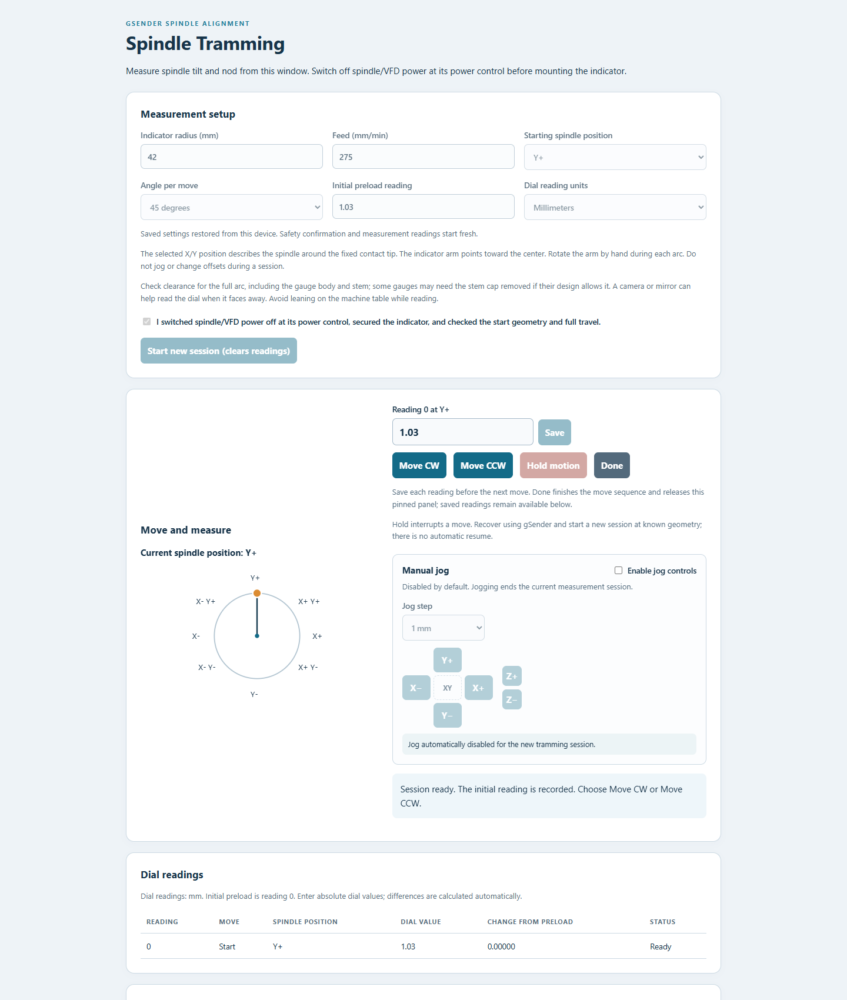
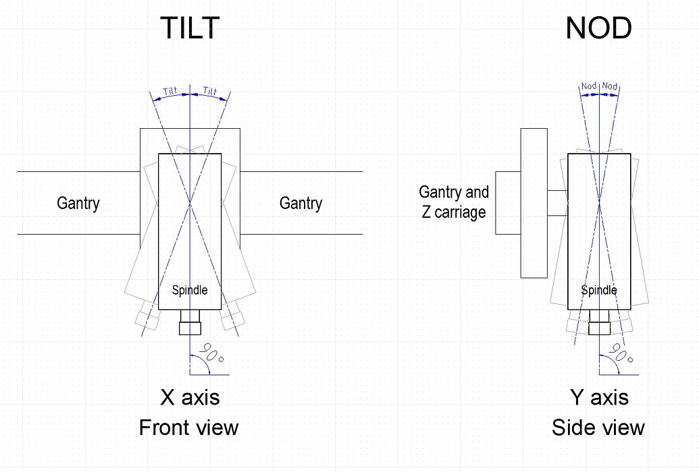
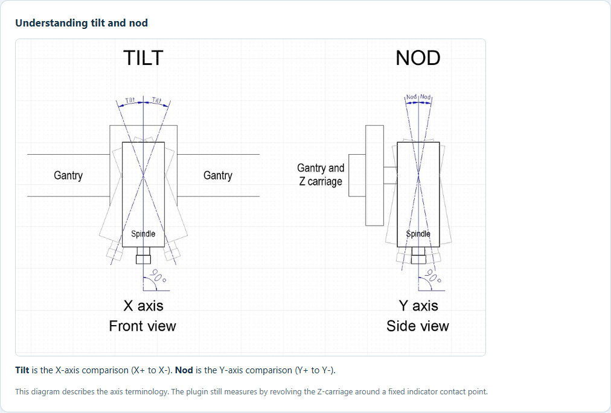
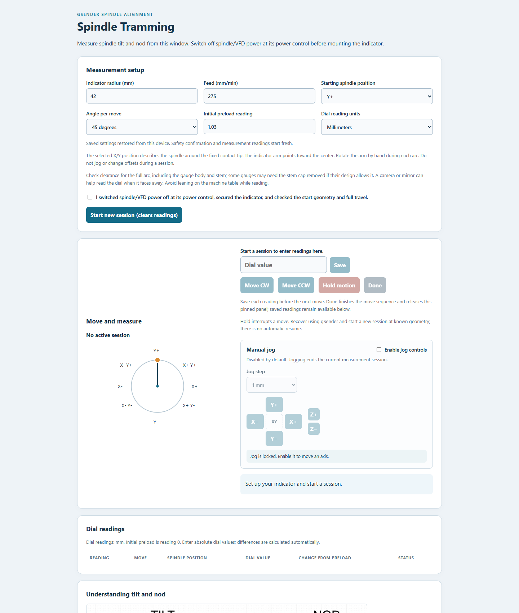
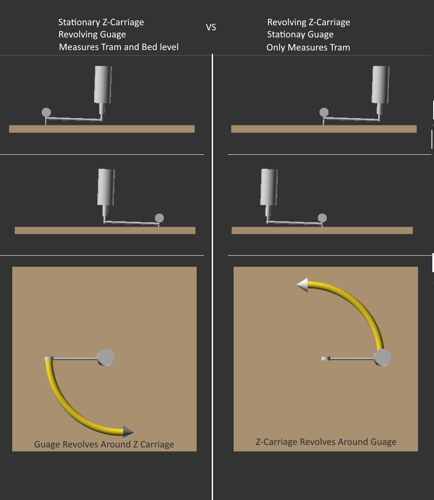
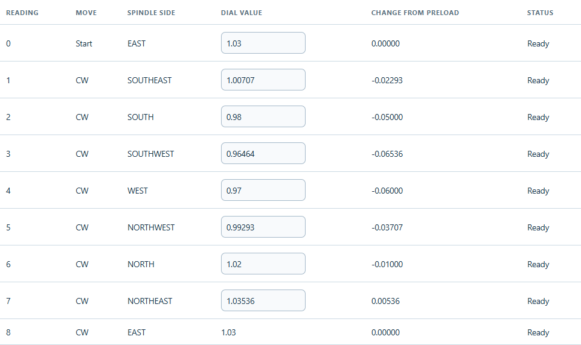
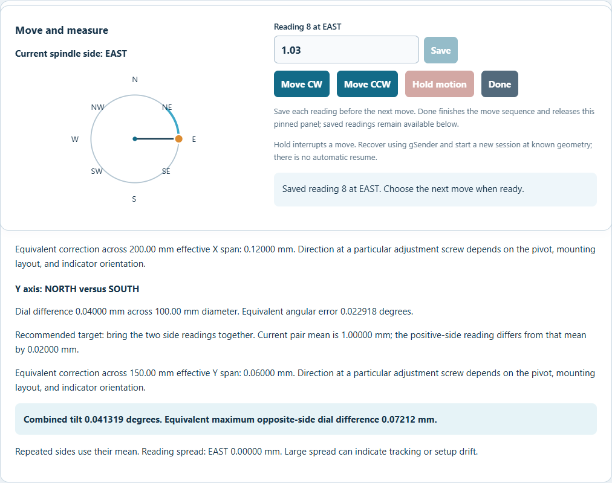
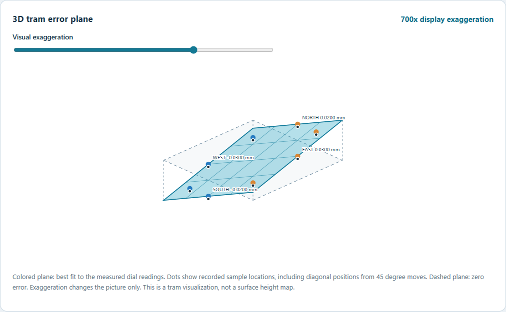

# Spindle Tramming for gSender Edge2

**Plugin 0.4.5 | gSender 1.7.0-Edge-2 | SDK 0.2.2**

An interactive tramming workspace: enter your setup, move the spindle clockwise or counterclockwise, record dial readings, calculate tilt and nod, and inspect a 3D error plane with adjustable visual exaggeration. The complete measurement process stays in the plugin window.

The setup values save locally in gSender and return when you leave the plugin and open it again. Measurement readings and the physical safety confirmation are session-only and start fresh each time.

The measurement panel also includes a separate manual jog pad for X, Y, and Z. It starts disabled and automatically locks again when a new tramming session starts. Enabling it during a session asks before ending that session.

## What changed in 0.4.5

- Adds a manual X/Y/Z jog pad with a selectable jog step and a separate enable switch.
- Removes the separate clearance checkbox; enabling jog immediately exposes the axis controls.
- Jog controls still require the controller to be connected, idle, unlocked, not running a host job, and reporting spindle-off M5.
- Updates the jog-panel screenshot to show the simplified controls.
- Enabling jog during a tramming session asks for confirmation and ends the current session; starting a new session disables jog again.
- Jog requests are limited to an idle, connected controller with spindle power reported off. The plugin checks the reported position after each jog and does not resume an interrupted measurement session.



*The manual jog panel starts disabled at the beginning of a new tramming session. The screenshot uses a simulated host; no CNC was moved.*

## What changed in 0.4.4

- Saves indicator radius, feed, starting side, angle, initial dial reading, units, correction spans, and visual exaggeration on this device.
- Restores valid saved settings when the plugin opens. Measurement rows and the spindle/VFD safety confirmation are not restored.
- Requests gSender plugin storage permission.

Version 0.4.3 labels spindle positions as X+/X-/Y+/Y- and names the measured axes tilt (X) and nod (Y). It also makes the physical spindle/VFD power-off check explicit and avoids sending a feed hold when only the post-move G90 acknowledgement times out.

> **Validation status:** The v0.4.5 UI build completed. Automated tests were not run. The screenshots use simulated gSender state; no real machine moved. Live gSender behavior and CNC jogging have not been validated yet.

## What changed in 0.4.3

- Cardinal and diagonal positions use machine-axis notation (X+, X-, Y+, Y-) instead of compass directions.
- Results identify the X comparison as **tilt** and the Y comparison as **nod**, with the user-provided diagram shown in the plugin and this README.
- The start confirmation explicitly requires spindle/VFD power to be switched off at its power control. The controller's M5 modal report remains a separate software check.
- If `G90` is not acknowledged after the completion dwell, the plugin reports that absolute mode needs checking and does not send a redundant feed hold after the arc has finished.
- Setup guidance calls out full-arc gauge clearance and suggests a camera or mirror to read the dial without leaning on the machine table.



*Tilt is the X-axis comparison (X+ to X-); nod is the Y-axis comparison (Y+ to Y-).*


*Current plugin interface with axis-based positions and updated safety/setup guidance. Captured in a local simulated host; no machine was moved.*



*The plugin explains tilt and nod beside the measurement workflow.*



*Example saved radius, feed, starting side, angle, and dial values restored when the plugin opens. Safety confirmation and measurement readings start fresh.*

## What changed in 0.4.2

- Angle choices are now **90 degrees (default)** and **45 degrees**; the larger 180 degree step was removed.

- The circular diagram tracks diagonal spindle positions during 45 degree moves.

- The 3D plane uses a least-squares fit across every valid sample and displays the measured sample points.
- The move and measure panel remains visible while you scroll through the reading history or results. After a move, enter the reading and press **Save**; the next move stays disabled until the reading is saved.
- **Done** ends the move sequence and releases the panel's pinned position. Saved readings remain available for review and calculation.
- Earlier readings remain editable in the history table.

- **Move CW** and **Move CCW** send one selected arc directly through the SDK.

- The circular diagram advances after motion completion and endpoint verification.

- Every move adds a table row with turn direction and destination side; enter its dial reading before moving again.

- Initial preload is recorded as reading 0.

- The results report tilt across X, nod across Y, angular error, and optional correction estimates.

- A 3D plane visualizes combined tram error, with a **1x to 1000x exaggeration slider**.

- No M0 pauses or job loading are used in this interactive workflow. The previous program-loading workflow is replaced.

- Machine commands remain ASCII only. No operator messages are sent to the controller.


*Figure 1: Setup and interactive controls after starting a session. This is the actual UI with simulated machine state; no real machine was moved.*

## Installation and permissions

1. Download `gsender-spindle-tramming-0.4.5.zip` and extract it.

2. Locate the extracted folder containing `gsender-plugin.json` and `ui/index.html`.

3. Open **gSender 1.7.0-Edge-2 → Tools → Plugins** and use the plugin import action.

4. Select that folder and review the permissions. **This version needs permission to read machine state, send machine commands, capture command responses, read Redux state, and save plugin settings locally in gSender.** Importing the SDK machine client may also produce a parser/stream permission in the host's capability scan, even though this release does not install a raw-stream parser.

5. Complete import and open **Spindle Tramming** from Tools. Restart the host if needed.

If updating from 0.2.x, reimport rather than retaining only the old visualizer permission. The plugin ID remains `community.spindle-tramming`. If the manager reports a duplicate, remove the old entry through the plugin manager and import the new package. Exact Edge2 installation/update screens remain unverified.

The package contains:

```
\<plugin folder\>/  
  gsender-plugin.json  
  README.md  
  docs/  
    images/  
      Explanation.png  
      tilt-nod.png
      04-interactive.png  
      08-tilt-nod-ui.png
      09-persistent-settings.png
      05-readings.png  
      06-error-plane.png  
      07-corrections.png  
  ui/  
    index.html  
    assets/  
    vendor/
```

Node.js is not required to install the built package. Do not open `ui/index.html` directly: it needs SDK paths and bridge services supplied by gSender. Source build instructions appear below.

## Why this method isolates spindle tram



The plugin checks whether the spindle axis is square to the Z-carriage’s circular XY travel. The Z-carriage revolves through several positions around one contact point. At each position the indicator tip remains on the same physical spot. If the spindle is square, the readings should stay nearly the same as the Z-carriage revolves. A consistent change between opposite positions indicates tram error; the plugin uses those differences and the recorded positions to calculate the result.

The right panel shows the key geometry: the Z-carriage revolves around a fixed gauge contact point. In the plugin, the gauge arm is mounted to the spindle. The gauge arm rotates in the spindle axis as the carriage moves so the tip stays on that fixed point.

### Why bed level and flatness do not enter the difference

Every reading is taken at the same physical spot. The bed's height or tilt at that spot is common to all readings, so it cancels when the plugin compares readings from different Z-carriage positions. Unevenness elsewhere on the bed is not sampled. This method measures spindle tram; it does not level the bed or measure bed flatness. The benefit depends on keeping the indicator tip on the same point with consistent contact and preload. If the tip drifts, the surface under it changes and can affect the readings.

### How different methods compare

| Method | What it compares | Advantages | Trade-offs |
| - | - | - | - |
| **Plugin fixed-contact method** | Dial readings at several Z-carriage positions while the tip stays on one point | Bed tilt and flatness elsewhere do not affect the reading difference; directly focuses on spindle tram | Requires careful manual tracking of one point, consistent preload, and a clear circular travel path |
| **Two-headed tram gauge** | Two indicator tips on opposite sides of the spindle, usually touching the bed at the same time | Fast, familiar, and gives an immediate side-to-side comparison | The two tips touch different spots, so bed tilt or unevenness between those spots can be mixed into the result |
| **Sweep a single gauge around the bed** | One indicator tip follows a circle across the bed as the Z-carriage revolves | Easy to visualize and useful when the bed is a trusted flat reference | The tip samples different bed locations, so bed tilt or local high/low areas can look like spindle tram error |

No method corrects the machine automatically. Use the results to guide mechanical adjustment, then measure again.

## Measurement principle and geometry

This plugin follows the fixed-contact approach of [bhowiebkr/spindle-tramming-tool](https://github.com/bhowiebkr/spindle-tramming-tool). The Z-carriage revolves around the fixed indicator contact point. The gauge arm is mounted to the spindle and rotates about the spindle axis as the Z-carriage revolves, keeping the indicator tip on that same point. The spindle motor remains off.

**The selected side describes the Z-carriage's position around the contact point, not the direction the indicator arm points.** The arm points toward the center.

| Displayed position | Z-carriage relative XY at 50 mm radius | Arm points |
| - | - | - |
| X+ | X +50 mm, Y 0 | X- |
| X+ / Y- | X +35.36 mm, Y -35.36 mm | X- / Y+ |
| Y- | X 0, Y -50 mm | Y+ |
| X- / Y- | X -35.36 mm, Y -35.36 mm | X+ / Y+ |
| X- | X -50 mm, Y 0 | X+ |
| X- / Y+ | X -35.36 mm, Y +35.36 mm | X+ / Y- |
| Y+ | X 0, Y +50 mm | Y- |
| X+ / Y+ | X +35.36 mm, Y +35.36 mm | X- / Y- |


The contact point need not be the work origin because every arc uses relative endpoints and incremental I/J centers. Correct physical radius and starting side are still essential: the plugin cannot see the indicator tip. No initial positioning or Z movement is generated.

The indicator must remain securely mounted and appropriately preloaded. Manual tracking, arm flex, friction, and inconsistent contact can affect the readings. The indicator arm must be free to rotate safely around the spindle axis without spindle power. Check gauge-body and stem clearance through the entire arc; depending on the radius and Z-carriage, the gauge's top stem cap may need to be removed if its design allows it. A camera or mirror can help read the dial when it faces away; avoid leaning on the table, which can change the reading.

## Setup controls

| Field | Meaning |
| - | - |
| **Indicator radius (mm)** | Horizontal distance from spindle axis to contact tip. Default 50. Software limit: greater than zero through 1000. Your available travel may be much smaller. |
| **Feed (mm/min)** | Arc feed. Default 300. Software limit: greater than zero through 10000. Choose a conservative speed that lets you follow the arm manually. |
| **Starting spindle position** | X+, Y-, X-, or Y+ relative to the intended fixed contact point. |
| **Angle per move** | 90 degrees (default) or 45 degrees. The same setting applies to both move buttons during the session. |
| **Initial preload reading** | Absolute dial value at the starting side, in the selected dial units. This becomes table row 0. It is not a commanded Z movement or target preload force. |
| **Dial reading units** | Millimeters or inches. Radius, feed, and correction spans remain metric. Calculations convert inch dial values into millimeters. |


Check the setup confirmation and press **Start new session (clears readings)**. This reads machine state and spindle modal state, records the initial row, and locks the setup fields. It does not move any axis. Starting a new session discards the previous reading table; copy values elsewhere first if needed.

The controller must be connected, Idle, unlocked, not running/paused on a host job, and not occupied by another feeder/plugin operation. It must report spindle-off modal state **M5**. Separately, switch off spindle/VFD power at its physical power control before installing or moving the indicator; M5 is only a controller state report and cannot verify that the motor is physically de-energized. A controller reporting absolute I/J centers G90.1 is rejected.

## Step-by-step operation

### 1. Establish the setup

1. Finish or stop any existing host job; the host workflow must be idle.

2. Switch spindle/VFD power off at its power control and secure the indicator arm.

3. Measure the horizontal radius and position the spindle on a known axis side (X+, X-, Y+, or Y-) of the intended contact point.

4. Point the indicator arm toward the center and apply suitable preload at the measurement Z height.

5. Check clearance for the full planned arc, including gauge body/stem, holder, arm, clamps, and machine travel. Some gauge stems may need the cap removed for carriage clearance, if the gauge design permits it.

6. Enter radius, feed, spindle starting position, angle, initial dial reading, and dial units.

7. Check the setup confirmation and start a session. The move panel then stays pinned while you scroll through history and results. After each verified move, enter the dial value and press **Save** before continuing.

On first use, perform a spindle-off dry run above the surface to verify direction, travel, endpoint checks, and the Hold control before making contact measurements. Use a camera or mirror to read the dial when it faces away; avoid leaning on the machine table while taking a reading.

### 2. Move clockwise or counterclockwise

Press **Move CW** or **Move CCW**. Clockwise is viewed from above. The labels show the Z-carriage's axis position relative to the contact point; they do not describe the direction the indicator arm points.

| From X+ | 90 degrees | 45 degrees |
| - | - | - |
| CW | Y- | X+ / Y- |
| CCW | Y+ | X+ / Y+ |


The plugin validates the current machine position and work coordinates against the last verified position, checks spindle state, then adds a row marked **Moving** with the selected turn and destination side. Reading inputs and other motion controls are disabled during the move.

The controller acknowledgement for an arc means it was accepted, not that it finished. The plugin therefore waits for a planner-synchronizing `G4 P0`, restores G90, and verifies the resulting machine/work XY endpoint and unchanged Z. The diagram changes position only after these checks succeed. Endpoint comparison tolerance is 0.02 mm per axis in both coordinate frames. If G90 is not acknowledged after the completion dwell, the arc is already finished: the plugin locks out more moves but does not issue a feed hold. Check the controller modal state in gSender and restore G90 before further movement or starting a job.

### 3. Enter the reading

When the new row becomes **Ready**, enter the absolute dial value in the pinned latest-reading field beside the move buttons and press **Save**. The value appears in the newest history row, and the change from initial preload is calculated in the table. A blank reading is not treated as zero. The next move remains disabled until the entered value is saved. Earlier rows remain editable in the history.

Press **Done** when you have finished moving the spindle. This ends the move sequence and releases the pinned panel so you can scroll normally. Saved readings stay in the table for calculations; if a latest value is still unsaved, you can save it after pressing Done.

Continue choosing CW or CCW for each subsequent measurement. There is no need to leave the plugin, load a file, press host Run, or respond to an M0 dialog. Move CW and Move CCW initiate actual motion when pressed.

### Manual jog controls

Manual jog is a separate mode from the measurement sequence and is disabled every time the plugin opens. Enable it and select a 0.1 to 10 mm step to expose the X/Y/Z controls. The plugin checks that gSender is connected, Idle, unlocked, not running a host job, and that the controller reports spindle-off M5. It sends one incremental move at a time, restores the previous units and motion modes, then checks the reported endpoint. The operator is responsible for checking clearance and travel before moving.

Starting a new tramming session turns manual jog off. If you enable jog while a measurement session is active, a warning asks whether to end that session. Confirming stops the session; if an arc is underway, the plugin requests a hold and requires you to recover/check the machine in gSender before jogging is enabled. Existing readings remain available, but the interrupted session cannot continue.

For a four-side check, use 90 degrees and make successive CW moves from X+:

```
X+ (initial reading) → Y- → X- → Y+ → X+
```

The closing X+ reading provides a repeatability check. With 45 degrees selected, successive CW moves from X+ visit X+ / Y-, Y-, X- / Y-, X-, X- / Y+, Y+, X+ / Y+, and X+. These intermediate diagonal samples add useful coverage for the fitted plane and can reveal tracking variation between axis sides. For tilt and nod, collect the corresponding X+/X- and Y+/Y- readings.



*Figure 2: A simulated 45 degree full-circle session. Diagonal spindle positions receive their own reading rows.*

### 4. Calculate tilt, nod, and correction

Press **Calculate tilt / nod and correction** after recording the needed readings.

- X+/X- gives tilt across the X axis.

- Y+/Y- gives nod across the Y axis.

- Opposite axis pairs give the tilt and nod values.

- Three or more non-collinear positions are enough to calculate the combined tilt and show the 3D plane. All valid samples, including diagonal 45 degree readings and repeat visits, contribute to its least-squares fit.

- Repeated visits to a side use their mean; the result also reports their spread.

- Blank, failed, and unsaved latest readings are excluded.

- Editing a reading or adjustment span clears the previous calculation; press Calculate again.

Optional **Effective X adjustment span** and **Effective Y adjustment span** fields accept the relevant lever/adjustment distances in millimeters. Leave them blank if you only need measured tram error. Use a span that matches the actual pivot/adjustment geometry; simply measuring a convenient bolt spacing may not establish the effective lever arm.

The recommendation is to equalize each opposite pair. A pair-mean target is shown, together with an equivalent correction magnitude across any supplied span. The plugin does not know your machine's pivot location, screw pitch, dial polarity, or mounting layout, so it does not prescribe which screw to raise/lower or how many turns to make.



*Figure 3: Example results for 50 mm radius, an X+/X- difference of 0.06 mm, a Y+/Y- difference of 0.04 mm, and optional spans of 200/150 mm.*

### 5. View the exaggerated 3D plane

Once there are at least three non-collinear measured positions, a 3D isometric error-plane view appears below the results. The fitted plane uses every valid reading; dots identify actual sample positions and deviations, including diagonal positions from 45 degree moves.

- The colored plane represents the best-fit dial error as a function of spindle side.

- The dashed plane is the zero-error reference.

- Orange markers show positive fitted deviation; blue markers show negative fitted deviation.

- X+/X-/Y+/Y- labels show fitted deviation. Dark dots show the actual readings at every sampled position; hover a dot to see its position and reading.

- The **Visual exaggeration** slider ranges from **1x to 1000x**, default **250x**.

The slider multiplies only the displayed vertical displacement. It never changes dial differences, angular errors, or correction values. The view can scale to keep large visual tilts in frame. It is an isometric projection of a mathematical plane, not a photo, live machine model, or table-surface topography map.



*Figure 4: Example error plane at 700x visual exaggeration. Cardinal labels show fitted deviations; dark dots mark actual readings at all recorded positions.*

### 6. Adjust and remeasure

Make mechanical adjustments according to your machine's procedure only after motion has stopped. Re-establish the actual starting side, radius, contact point, and preload, then start a fresh session. Settings and readings are page-session-only; reopening the plugin does not restore the previous physical setup or data.

Do not jog, change work offsets, adjust Z, or reposition the indicator during a measurement session. The next move assumes the previous verified geometry remains valid. Position/offset changes detected at the next move invalidate the session.

## Hold and error recovery

**Hold motion** sends a realtime feed hold. It is not an emergency stop or an automatic resume mechanism. A hold invalidates the current session; pending rows are marked Failed when the operation unwinds, and the side is treated as uncertain. Use the host/machine controls for recovery, restore known geometry, and begin a new session.

If a controller command fails or completion cannot be confirmed, the plugin does not advance the diagram to the requested position. If an arc may still be moving, it requests feed hold and blocks further plugin moves. Once `G4 P0` confirms the arc completed, a later G90 acknowledgement timeout does not trigger feed hold; the plugin locks out further moves and tells you to verify absolute mode. Never assume a motion timeout stopped the machine: use the machine's stop controls when needed.

Keep the plugin open during a move. Closing the view attempts a best-effort hold, but browser lifecycle delivery is not guaranteed. After navigating away, resetting, disconnecting, or recovering a machine alarm, start a new session.

## Calculation details

Readings are grouped by axis position and converted to millimeters. Let the mean readings be X+, X-, Y+, and Y-, with indicator radius R:

```
Diameter D = 2 R  
Tilt difference (X) = X+ - X-
Nod difference (Y) = Y+ - Y-
X equivalent slope = (X+ - X-) / D
Y equivalent slope = (Y+ - Y-) / D
Tilt angular error = atan(X slope)
Nod angular error = atan(Y slope)
Combined angular error = atan(sqrt(X slope^2 + Y slope^2))  
Maximum opposite-side error = D sqrt(X slope^2 + Y slope^2)  
Equivalent span correction = abs(axis difference) span / D
```

The visual plane is a least-squares fit `z(x,y) = baseline + X slope \* x + Y slope \* y` across all valid recorded positions, including diagonal 45 degree samples. At least three non-collinear positions are needed. The dark dots show actual samples; their height retains the recorded deviation, while the colored plane shows the best fit. It models equivalent dial error in spindle-side coordinates; it does not map the table surface or establish the physical direction of spindle lean. The named X/Y comparison values and correction estimates use opposite cardinal readings. They do not prescribe screw direction without indicator and mount orientation.

Example: a 0.06 mm difference across a 100 mm diameter corresponds to slope 0.0006 and approximately 0.034377 degrees. Across an effective 200 mm adjustment span, the equivalent height correction magnitude is 0.12 mm. The pair mean gives a useful matching target, not an absolute dial value guaranteed after mechanical adjustment.

Preload is a common reading offset, so it cancels out of opposite-pair differences. Large repeated-side spread or inconsistent contact reduces confidence; the plugin does not automatically certify the measurement or impose a universal acceptable tram tolerance.

## Commands and controller behavior

A typical 90-degree clockwise move starting at X+, with radius 50 mm and feed 300 mm/min, sends these acknowledged SDK queries sequentially:

```
$G  
G21 G17 G91 G94  
G2 X-50.0000 Y-50.0000 I-50.0000 J0.0000 F300.0000  
G4 P0  
G90
```

`$G` reads modal state and must report M5. `G21` selects millimeters, `G17` the XY plane, `G91` relative endpoints, and `G94` feed/minute. G2 is clockwise; G3 is counterclockwise. Incremental I/J arc centers are assumed. `G4 P0` waits for queued motion to complete, then G90 restores absolute endpoint mode. If the G90 acknowledgement times out after the dwell has completed, the plugin marks the session uncertain but does not send a feed hold because the arc is no longer in progress.

All controller-bound strings are checked for printable ASCII. There are no operator messages, Unicode characters, M0 stops, M2 program ends, spindle commands, initial positioning, or Z moves in this interactive path. Negative coordinate minus signs remain necessary and are preserved.

The current host job is not replaced. Motion is issued by the plugin's query interface while the host workflow is idle; it does not deliberately invoke job start/pause/resume/end automations. Normal units/plane/feed mode after a completed move are G21/G17/G94/G90; previous modal settings are not restored. If interrupted before G90, review the controller state before unrelated operations.

The plugin reads top-level Redux machine/work positions, which the Edge2 controller slice normalizes to millimeters. It does not assume raw firmware status positions use millimeters when `$13` requests inch reports.

## Troubleshooting

| Symptom | Action |
| - | - |
| Permission errors after upgrading | Reimport and approve the new machine/query/Redux permissions. Old visualizer-only grants are insufficient. |
| Begin asks for setup confirmation | Check the confirmation after verifying the actual physical setup. |
| Machine must be Idle/unlocked | Resolve the host job or controller condition through normal gSender procedures. No automatic unlocking is performed. |
| Spindle must report M5 | Confirm the controller reports M5. Separately switch off spindle/VFD power at its physical power control; the plugin cannot verify physical motor power. |
| Move buttons disabled after arrival | Enter a finite latest reading and press Save. Zero is valid; blank is not. |
| Reading row remains Moving | Wait for motion completion. If movement is unexpected, use Hold or the machine stop controls. |
| Position/offset changed | Restore known geometry and begin a new session. |
| G90 acknowledgement timeout after motion | Do not repeat the move. Check gSender's modal report and restore G90 before further motion or running a job. The plugin does not send feed hold after its completion dwell confirms the arc is finished. |
| error:9 or another controller error | Preserve console history and inspect the actual controller state. The plugin locks out further moves; do not assume a text-format issue or automatically unlock/resume. |
| Only one axis comparison calculated | Measure the other opposite pair: X+/X- for tilt or Y+/Y- for nod. Diagonal samples contribute to the plane fit but do not replace either pair. |
| 3D plane absent | Record at least three non-collinear positions, then press Calculate. |
| Slider changes picture but not correction | Expected. Exaggeration is visual only. |
| Values differ from expectations | Confirm dial units, measured radius, selected spindle position, contact tracking, and repeated-side spread. |
| Settings/rows lost | Page-session state only. Copy values elsewhere before reload or a new session. |


## Development and validation

From the source directory, using Node.js and npm:

```
npm ci  
npm test  
npm run build
```

`ui/` is the built importable interface. SDK imports remain external and resolve to gSender's host SDK copy. Source conventions were checked against [gSender v1.7.0-Edge-2](https://github.com/Sienci-Labs/gsender/tree/v1.7.0-Edge-2), commit `19bb36c666618b2b5332cbd7f94e106532a839d3`, including its [SDK docs](https://github.com/Sienci-Labs/gsender/tree/v1.7.0-Edge-2/packages/plugin-sdk), query handling, and normalized Redux positions.

| Source | Responsibility |
| - | - |
| `src/main.js` | Setup, move buttons, table, calculation results, SVG plane and slider |
| `src/motion.js` | Session validation, acknowledged queries, completion/endpoint checks and hold handling |
| `src/analysis.js` | Opposite-pair error, units, correction estimates, and sampled best-fit 3D plane data |
| `src/geometry.js` | Arc generation and ASCII validation; earlier sequence generator retained for regression coverage |
| `test/` | Geometry, arithmetic, exaggeration invariance, and simulated motion-state tests |
| `docs/images/` | Screenshots from isolated browser simulation |


The automated and browser checks verify the software model, not physical CNC behavior. Live Edge2 permission prompts, SDK query timing, hardware Hold behavior, endpoint precision, indicator tracking, and actual measurement accuracy remain to be validated. No mechanical adjustment is automatically applied.
