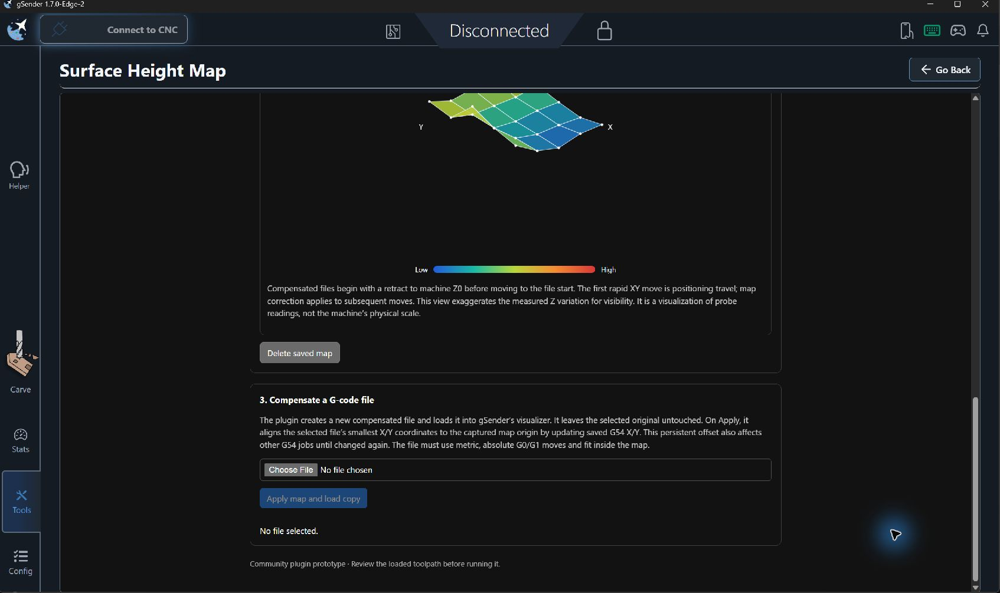

# Surface Height Map (File First)

This is a separate experimental gSender plugin that keeps the surface-map probing, visualization, STL preparation, and G-code compensation workflow while changing the order of operations. The project G-code is imported first so the plugin can derive the calibration area and sampling grid from the actual toolpath. The existing **Surface Height Map** plugin is unchanged by this experiment.

The plugin is designed for gSender's current plugin SDK and Edge builds. It uses the supported machine query/command, plugin storage, parser, and visualizer APIs. It does not request unsupported host-side file downloads or automatic page navigation.

Version 0.1.4 adds a live percentage beside the calibration progress bar and a scrollable table of the latest ten X/Y/Z readings. Version 0.1.3 lets one saved scan be applied to subsequent imported files whose complete XY extents fit within the scanned bounds. The scan stays unchanged when importing another file; its lower-left origin is used for G54 alignment. Version 0.1.2 adds a saved probe-area alignment option: use machine X0 Y0 as the lower-left corner or center the imported project's extents on machine travel. Version 0.1.1 keeps the controller's probe-position parser active for the plugin session and matches delayed `[PRB:...]` reports to the active grid point. The same fast/slow probe path is used for conductive and non-conductive surfaces.

## Screenshots

These captures show the project-derived map setup, saved surface visualization, and the workflow for applying a map to a G-code copy.




## Workflow

1. **Connect and import the project.** Connect to the CNC in gSender, then choose the project G-code file. The plugin requires metric (`G21`) and absolute (`G90`) XY coordinates so it can find the full project bounds.
2. **Choose the probe-area alignment and check the machine envelope.** Choose **Start at machine X0 Y0** to keep the original workflow, or **Center project on machine travel** to place the project-sized probe area symmetrically around the midpoint of `$130`/`$131`. The plugin calculates project width and height from its smallest and largest absolute coordinates. It checks the extents fit before enabling homing and calibration.
3. **Review the generated grid.** When the project fits, the plugin fills in Length X and Width Y from the project extents. It chooses X/Y point counts so neighboring samples are at most 10 mm apart and the grid has at least 50 points total. These four project-derived fields are read-only. Probe travel, feeds, retracts, surface type, and puck thickness retain the values saved in this plugin's own settings.
4. **Home the machine in the plugin.** Click **Home machine and set origin**. The plugin verifies that the controller reports machine X0 Y0 after homing and remembers homed Z. It sets the probe grid's lower-left origin to machine X0 Y0 or to `((maxX - projectWidth)/2, (maxY - projectHeight)/2)` for center alignment. Calibration stays disabled until import/limit validation and homing both succeed.
5. **Calibrate and supervise.** Click **Start calibration**. The progress bar shows a percentage as probe points complete. The live table shows the latest ten readings, newest first, with machine X/Y, absolute machine Z, and Z offset relative to the first probe point (with puck thickness corrected for non-conductive probing). The plugin uses the same fast/slow `G38.2` sequence, conductive clip or non-conductive puck prompts, short post-probe retract, saved map, and surface preview as the original plugin. Stay with the CNC during every move.
6. **Apply the map to one or more files.** A saved map can be reused for later imports while each file's full X/Y extents fit within the scanned width and height. Import another file and the plugin checks it against the saved scan; it does not overwrite the map. **Apply map and load copy** aligns that file's smallest X/Y coordinates to the saved scan's lower-left corner by updating G54 X/Y. G54 is persistent and affects other G54 jobs until changed again. Each source file is left untouched; the compensated copy is loaded into the visualizer. Open Carve manually to review it.

With zero alignment, the probe area starts at machine X0 Y0. With center alignment, the project width and height define equal positive/negative extents around the geometric center of machine XY travel. The CNC is still homed first, and the full probe area must be clear in either mode.

## Settings

The plugin keeps its settings separately from the existing plugin because it has its own identifier and storage namespace.

| Setting | Behavior in this workflow |
| --- | --- |
| Length X / Width Y | Set from the imported file's max-min X/Y bounds after machine travel validation. |
| X / Y samples | Automatically computed: no more than 10 mm between adjacent points and at least 50 grid points total. |
| Probe area alignment | Saved selection between machine-zero lower-left and centering the project extents on machine XY travel. |
| Post-probe retract | Preserved from this plugin's settings; defaults to 3 mm on a fresh install. |
| Probe travel | Preserved; fresh-install default is 25.5 mm. |
| Fast feed / Slow feed | Preserved; fresh-install defaults are 100 / 20 mm/min. |
| Slow probe travel / Interim retract | Preserved; fresh-install defaults are 3 / 2 mm. |
| Surface type / Probe puck thickness | Preserved. Puck thickness is displayed and applied only for non-conductive probing. |

File coordinates are not rewritten when the project is loaded into the plugin. During **Apply map**, the plugin calculates the persistent G54 offset that moves the file's minimum X/Y to the selected map origin. Review the confirmation and the loaded visualizer copy before running any job.

## Requirements and limitations

- A live connection to the CNC is required to import and validate a project against controller `$130`/`$131`/`$132` limits. If the file is selected while disconnected, connect and click **Check project and machine limits**.
- Input G-code must explicitly use metric units and absolute positioning before XY coordinates. The compensation stage retains the same supported G-code subset documented by the original plugin: metric, absolute linear G0/G1 toolpaths that fit the map.
- The controller must accept `G38.2`, report successful `[PRB:...]` positions, and have a verified probe input.
- After homing, the controller must report machine X0 Y0. Center alignment changes where the probe grid is placed after homing; it does not redefine the controller's home coordinates.
- Grid generation rejects a project with zero width or height, a project outside machine XY travel, or more than 101 samples on either axis.
- STL preparation uses plugin storage; it does not save directly to Downloads. Each stored value is limited by the current gSender plugin bridge to 256 KiB. Copy the generated STL text into a plain-text editor and save it using the shown `.stl` filename.
- The plugin does not automatically navigate to Carve because that is not available through the Edge API version targeted here.

## Install and build

In gSender, install the plugin ZIP from this plugin's `dist/` directory. It appears as **Surface Height Map (File First)**, alongside the original plugin.

For standalone source development, use Node.js 18+:

```sh
npm install
npm test
npm run build
```

The build uses the published `@sienci/gsender-plugin-sdk` package, so it does not need a gSender source checkout.

Then package the built plugin:

```powershell
./package-plugin.ps1
```

The packager creates `dist/surface-height-map-file-first-v<version>.zip`. The current experimental version is `0.1.4`; it has its own plugin ID, route, storage, and settings.

## Safety

Homing, XY moves, probing, G54 changes, and compensated G-code are machine operations. Verify machine travel, the probe circuit, clearances, tool height, and G54 readback. Keep the spindle off for the first air-move check, supervise calibration in person, and review the complete toolpath in the visualizer before cutting. This workflow is an experiment for testing; a successful software preflight does not prove physical safety.

