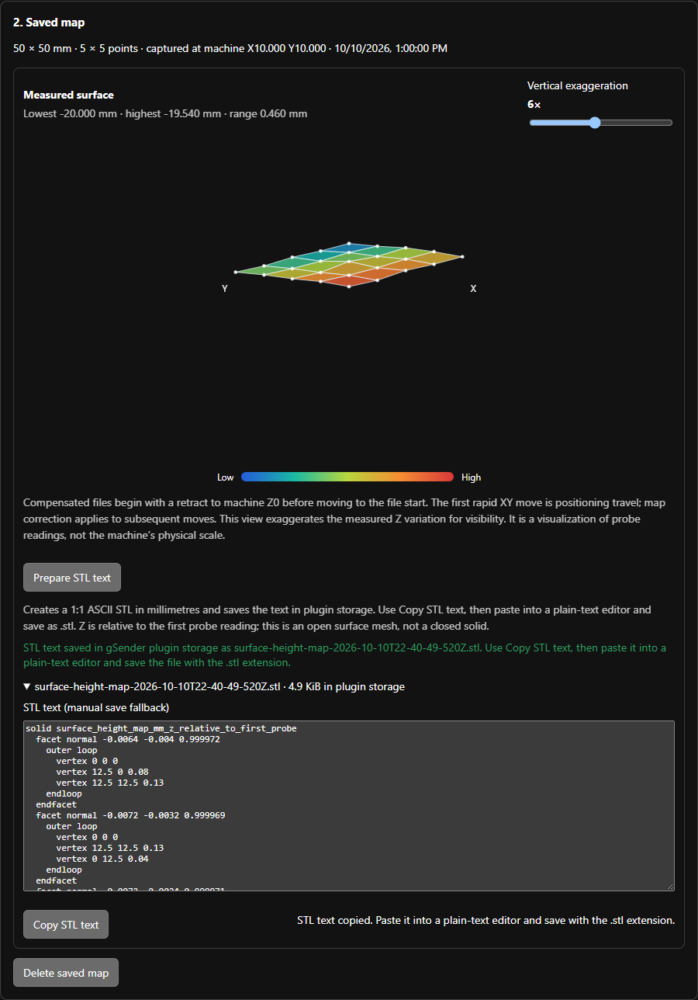

# Surface Height Map for gSender

Surface Height Map is a community gSender plugin for measuring a work surface at a regular grid of probe points, then applying those readings to a supported G-code toolpath. Calibration is saved independently of any one job, so you can map the material or spoilboard once and use that map to preprocess files whose XY footprint fits inside the mapped area.

The plugin creates and loads a **new compensated copy**. It does not edit the selected source file. Its first supported workflow targets metric, absolute, linear G-code on GRBL-compatible machines.


*The setup page is shown disconnected, so motion controls are disabled. The screenshot uses a 50 × 50 mm, 5 × 5 example map; the fresh-install defaults are 150 × 110 mm and 15 × 11 points.*

## What it does

- Homes the machine, captures a machine-coordinate map origin, checks the planned grid against the controller's reported travel limits, and probes a regular XY grid.
- Supports a conductive work surface with the clip attached for the full run, or a non-conductive surface with a probe puck moved to each point.
- Saves the measured map and calibration settings in gSender plugin storage so the map is available after restarting gSender.
- Shows the sampled surface as a color-coded 3D-style grid, with minimum, maximum, range, and a vertical exaggeration control.
- Prepares a true-scale STL surface mesh in millimetres and stores the generated text in gSender plugin storage for copying into a local `.stl` file; vertical exaggeration affects the preview only.
- Preprocesses compatible G-code using bilinear interpolation, writes a new `-heightmapped` file, and loads that copy into gSender's visualizer.
- Aligns the selected file's minimum X/Y coordinates to the captured map origin by updating the controller's saved G54 X/Y offsets after confirmation.

The map viewer intentionally exaggerates height variation to make small differences visible. Its apparent slope is not a physical-scale drawing and should not be used to estimate actual Z travel.


*Example saved 50 × 50 mm map with 5 × 5 measured points. The numeric range and colors are readings from the example calibration shown in the local gSender session.*

## Requirements and compatibility

- gSender Edge with the plugin support required by the manifest (Edge 1.7 or later).
- A connected controller that accepts standard GRBL-style `G38.2` probing commands, reports successful probe positions as `[PRB:...]`, and exposes a probe state to gSender (commonly `Pn:P`).
- Valid controller travel settings `$130`, `$131`, and `$132`. The plugin uses them to reject a grid or start position outside machine travel.
- The probe input must be electrically verified before calibration. Check the controller's probe status with the contact open and closed; confirm that contact changes the reported probe signal and that the controller's polarity is configured correctly.

The initial reference machine is a Cubiko running custom V45.4 control-panel and system-board firmware from the [N0JCG Cubiko firmware patches](https://github.com/bakstaaj/N0JCG-Cubiko-FW-Patches). That firmware combines the built-in bed sensor and external probe jack into the same active probe input. **Cubiko firmware is not a plugin dependency.** Other GRBL-compatible machines may work if they provide the probe reporting and coordinate behavior above, but have not been validated here.

Automatic navigation back to Carve is optional and depends on the host gSender build providing the matching navigation bridge. If it is unavailable, the plugin reports that the copy was loaded and asks you to open Carve manually.

## Install

1. In gSender, open **Tools → Plugins → Install**.
2. Select the plugin ZIP or folder containing `gsender-plugin.json`, `README.md`, `docs/`, and the built `ui/` directory.
3. Review the plugin identity and requested permissions before installing. Machine write/query/parse permissions allow the plugin to home, move, probe, and read controller state; storage saves settings, the map, and a prepared STL text export; visualizer permission loads the compensated copy.
4. Open **Surface Height Map** from the Tools page.

For a standalone source build, use Node.js 18 or later and run these commands from this directory:

```sh
npm install
npm test
npm run build
```

The build uses the published `@sienci/gsender-plugin-sdk` package, so it does not need a gSender source checkout.

The PowerShell packager creates `dist/surface-height-map-v<version>.zip` after `npm run build`:

```powershell
./package-plugin.ps1
```

The package includes the README screenshots so the relative image links work when the package is extracted.

## Calibrate a map

### 1. Set the map and probe parameters

| Setting | Fresh-install default | Purpose |
| --- | ---: | --- |
| Length X | 150 mm | Map width along machine X, measured from the captured origin. |
| Width Y | 110 mm | Map width along machine Y, measured from the captured origin. |
| X samples | 15 | Number of evenly spaced probe locations along X, including both edges. |
| Y samples | 11 | Number of evenly spaced probe locations along Y, including both edges. |
| Post-probe retract | 3 mm | Short upward retract after each measured point, capped at the Z position recorded during homing. |
| Probe travel | 25.5 mm | Maximum downward distance for each initial fast touch. Choose enough travel to reach the surface safely. |
| Fast feed | 100 mm/min | Feed for the first touch. |
| Slow feed | 20 mm/min | Feed for the repeat touch. |
| Slow probe travel | 3 mm | Maximum downward travel for the slow touch. It must exceed the interim retract distance. |
| Retract | 2 mm | Upward move between the fast and slow touches. |
| Probe puck thickness | 1.53 mm | Shown and used only for non-conductive probing; subtracted from each puck contact reading. |

Settings are saved in gSender plugin storage as they are changed. More samples improve spatial detail but increase the number of machine moves and calibration time. A 15 × 11 grid requires 165 measured points.

Set Length X and Width Y to at least the planned project's full machine-coordinate X/Y extents from the map origin. The complete grid must also remain inside the machine travel reported by `$130`/`$131`/`$132`. The map dimensions are not the overall machine travel; they describe the rectangular area you intend to measure.

### 2. Home and move to the lower-left map corner

1. Connect to the CNC and make sure the tool/probe can travel without hitting clamps, stock, or other obstructions.
2. Click **Home machine** in the plugin. The plugin records the homed machine Z position for its retract checks. Homing elsewhere in gSender does not set this plugin's homing state; use the plugin button before calibration.
3. Position the probe over the lower-left corner of the area you want to map. You can jog from gSender or enter machine-coordinate targets in **Start X machine** and **Start Y machine**, then click **Go to start X/Y**. The move preserves the current Z, so check that the tool is clear along the whole XY path.
4. Click **Use current machine position as origin**. This stores the current machine X/Y as the map's lower-left origin. Calibration controls stay unavailable until the machine has been homed and an origin has been captured.

### 3. Select the contact method

- **Conductive surface:** connect the probe clip to the conductive material and leave it attached for the entire calibration. The plugin pauses once before the first point so you can confirm the clip is attached.
- **Non-conductive surface:** choose this for an insulating surface and use a probe puck. Set **Probe puck thickness** to the puck's actual thickness. The plugin moves to a point, pauses for you to place the puck, probes, then asks you to move it to the next point. Keep hands clear before continuing each prompt.

The puck-thickness value applies only to the non-conductive method; it is ignored for conductive probing.

### 4. Start and supervise probing

Before the first move, the plugin checks the controller is idle, verifies that machine Z is still at its recorded homed position, reads the travel limits, and validates the whole grid and probe settings. If you have moved Z since homing, return it to the homed position before starting.

At each grid point the plugin performs a fast `G38.2` touch, retracts by the interim amount, performs the slower `G38.2` touch, records the stopped machine Z, and makes the configured short post-probe retract toward the recorded homed Z. It does not command a full retract after every probe. On successful completion it moves to machine Z0 and then machine X0/Y0, saves the completed map, and refreshes the viewer. An incomplete or stopped run is discarded; the previously saved map remains available.

Keep the spindle off and remain at the machine during all automatic motion. If a probe is missed or the controller enters Alarm, resolve the controller state before trying again. Use **Stop after current move** to stop the calibration at a safe point; do not reach into the work area while the controller is moving.


*The saved map panel reports the sampled range and offers a vertical exaggeration slider. The file selector and apply button appear below it.*

## Read and export the saved map

The saved-map panel reports the dimensions, sample count, captured machine origin, capture time, and measured minimum/maximum/range. The 3D-style plot colors low-to-high measurements and connects the measured grid points. Adjust **Vertical exaggeration** to make small height changes easier to see; it affects the drawing only and does not change map data or compensation.

### Save the prepared STL as a file

The plugin SDK used by current gSender Edge builds can persist plugin data, but it does not expose a supported API for writing a file into Downloads or another folder. The STL workflow therefore prepares the file text in plugin storage and lets you save it manually:

1. In **2. Saved map**, click **Prepare STL text**. The plugin creates an ASCII STL and stores its filename and text with the saved map in gSender plugin storage. It does not create a file on disk or save to Downloads.
2. The export panel opens and displays the generated filename, stored size, and STL text. The prepared export remains available after restarting gSender. A new successful calibration replaces the old map and clears its prior STL export; deleting the map clears both.
3. Click **Copy STL text**. When clipboard access succeeds, the plugin confirms the text was copied. Paste it into a plain-text editor such as Notepad.
4. Save the text using the exact `.stl` filename shown in the panel. In Notepad’s Save As dialog, set **Save as type** to **All files (*.*)** so Windows does not append `.txt`; UTF-8 encoding is suitable.


*Example 50 × 50 mm map. The screenshot uses sample readings to show the UI; it does not represent a live CNC session.*



*After clicking **Copy STL text**, paste the clipboard contents into a plain-text editor and save using the displayed `.stl` filename. If clipboard access is blocked, the plugin selects the complete text in its text area; press Ctrl+C, then paste and save it manually.*

The STL record is limited by the current gSender plugin storage bridge to 256 KiB per value. If a dense grid exceeds this cap, the plugin reports the size instead of claiming it was prepared. Reduce the X/Y sample counts and recalibrate to create a smaller mesh. The mesh uses the captured map origin as X/Y zero: its bounds span Length X and Width Y in millimetres at 1:1 scale. Each vertex's Z is the measured height change relative to the first probe reading. Preview exaggeration is not applied.

The mesh uses the captured map origin as X/Y zero: its bounds span the configured Length X and Width Y in millimetres at 1:1 scale. Each vertex's Z is the measured height change relative to the first probe reading, also in millimetres. The preview's vertical exaggeration setting affects only the on-screen visualization and is not applied to the export.

The STL is an open surface mesh with no side walls or bottom face. It is useful for inspecting or combining the measured surface in CAD/CAM software, but it is not a closed solid for 3D printing without additional modeling. The export is generated from the saved map and does not modify the map or the selected G-code file.

The plugin saves a new map only after every point has a valid measurement and the final return moves complete. If a run fails, check the error near the top of the page and the controller console before retrying. The old completed map is retained when a new attempt fails.

## Apply the map to a G-code file

### File requirements

The current preprocessor deliberately supports a narrow format:

- The file must explicitly select metric units with `G21` and absolute positioning with `G90`.
- Use linear `G0`/`G1` moves, an active **G54** work coordinate system, and ordinary X/Y/Z axes.
- The first positioning move must be a `G0` that specifies both X and Y. That move establishes the file start and is treated as setup travel; later supported XY path moves receive height correction.
- The whole XY toolpath must fit within the mapped rectangle after alignment. The plugin refuses to extrapolate outside measured points.
- The plugin rejects arcs (`G2`/`G3`), incremental positioning (`G91`), coordinate-system changes and transforms in the file, canned cycles, macros/subprogram blocks, line numbers/checksums, rotary or additional axes, and spindle/tool `M`/`S`/`T` words on the same line as an XY move. Export plain metric, absolute, linear G-code if the file uses one of these features.

### Apply steps

1. Confirm the correct completed map is shown in **2. Saved map**.
2. In gSender, select **G54** and make sure the machine is idle. The plugin reads `$G` to confirm the active work coordinate system, and reads `$#` for G54 and G92 offsets.
3. In **3. Compensate a G-code file**, choose the original file, then click **Apply map and load copy**.
4. If the file's minimum X/Y coordinates require an offset change, review the confirmation dialog. The plugin sets G54 X/Y so the file's minimum X/Y land on the captured map origin. The G54 Z offset is left alone. The plugin reads the saved offsets back and refuses to load the file if the controller's response does not match.
5. Review the loaded compensated copy in gSender's visualizer. If your gSender build does not support automatic navigation, open **Carve** manually after the success message.

The selected source file is not modified. The generated copy is named `<source-name>-heightmapped.<extension>`. It starts with `G53 G0 Z0` to retract in machine coordinates before file positioning. It ends with a machine-coordinate move to Z0 followed by machine X0/Y0 before the program end. The first rapid XY move is not map-compensated; subsequent linear XY moves are split into shorter segments and adjusted using bilinear interpolation of the saved readings.

### G54 is persistent

G54 is stored by the controller and is shared by other jobs. When the plugin aligns the file, it writes G54 X/Y using `G10 L2 P1`, accounts for the reported G92 offset in its calculation, and verifies the resulting `$#` data. This can change how other G54 programs are positioned until you set a different work offset. Check the confirmation dialog and verify your offsets before running a job. The plugin does not auto-align G55 through G59.

The map and file are aligned by their XY coordinates: the smallest X/Y in the file maps to the saved map origin, and the file's X/Y spans must not exceed the map's Length X/Width Y. For a project wider than the measured rectangle, enlarge the map and recalibrate; do not shrink or crop the job just to hide an out-of-map error unless that is intended.

## Troubleshooting

| Message or symptom | What to check |
| --- | --- |
| **Not connected** or Home is disabled | Connect to the controller in gSender. The plugin needs a live machine connection for calibration and offset checks. |
| Start, origin, or calibration controls are disabled | Click **Home machine** in this plugin. After homing, move to the map corner and capture the origin. |
| Map exceeds machine travel / invalid `$130`–`$132` | Verify the controller's X/Y/Z travel settings and reduce the grid dimensions or move the origin so every point remains within travel. |
| Probe did not trigger, or `PRB` reports failure | Check the probe wiring, contact, polarity, travel distance, and whether the controller reports probe contact (often `Pn:P`). Test contact before probing the full grid. |
| `ok` appears but no `[PRB:...]` report arrives | The plugin waits for the probe position report as well as command acknowledgement. Confirm the controller's probe report reaches gSender's parsed response stream; `ok` alone is not a measured contact. |
| Calibration says return Z to its homed position | The plugin requires Z to remain at the position it recorded during its **Home machine** cycle before calibration. Re-home and start again. |
| Toolpath leaves mapped area at X… Y… | Increase Length X/Width Y or capture a new origin/recalibrate to cover the full toolpath. The preprocessor will not extrapolate the surface beyond the sampled rectangle. |
| Active coordinate system is not G54 | Select G54 in gSender and retry. This version aligns only G54. |
| Missing G54 or G92 in `$#` response | Confirm the controller returns `[G54:X,Y,Z,...]` and `[G92:X,Y,Z,...]` records and that gSender receives those records after querying `$#`. |
| File rejected as unsupported | Export metric (`G21`), absolute (`G90`) linear G-code with a first `G0 X… Y…` positioning move. Remove unsupported arcs, transformations, macros, canned cycles, rotary axes, line numbers, or checksums. |
| File loaded but gSender did not switch to Carve | Open Carve manually. Automatic navigation requires a host-side plugin bridge that may not be present in every Edge build. |
| STL text is too large to prepare | gSender's current plugin storage bridge limits each stored value to 256 KiB. Reduce the X/Y sample counts and recalibrate to generate a smaller STL. |
| Clipboard copy does not work | The plugin selects the STL text as a fallback. Press Ctrl+C, paste into a plain-text editor, then save using the displayed `.stl` filename. Set **Save as type** to **All files (*.*)** to prevent a `.txt` extension being added. |

## Test files

`test-files/` contains small 50 × 50 mm example files for checking import and Z compensation. These are preview/test programs, not validated cutting jobs. The Z-compensation preview uses a constant nominal height and changing Z values to make map application visible. Always inspect the full toolpath and confirm the work offset before running any generated file.

## Safety and validation

This plugin commands real homing, XY movement, and probe motion. Verify clearances and probe operation before calibration, keep hands and cables clear, and supervise the complete process. A visualizer preview is not a substitute for verifying the physical setup. Start with spindle off and a conservative air move or other safe test before cutting.

Initial integration work uses a Cubiko and custom V45.4 firmware; compatibility with other controllers, probe circuits, gSender builds, and cutting workflows has not been established. Treat the plugin as an experimental community prototype and verify its behavior on your machine before relying on a compensated toolpath.

